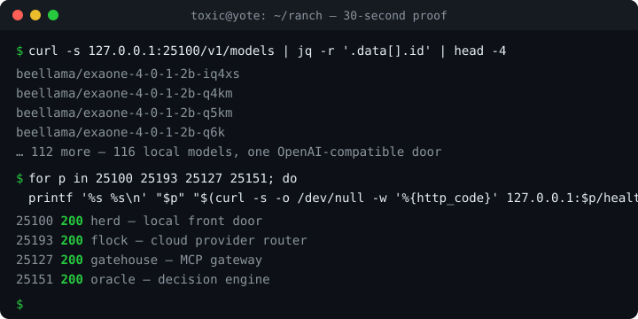

# 🤠 ranch

**The whole self-hosted AI estate in one monorepo.** Local model serving (**herd**), cloud provider routing (**hodos**), the canonical router (**cuttinggate**), the coding agent (**tau**), the MCP gateway (**gatehouse**), the build-job system (**forge**), fleet chat (**keryx**), and the provider catalog (**roost**) they all share — one directory per component, the full mesh on one box, everything OpenAI-compatible.

[Explore the docs »](docs/) · [Report Bug](https://github.com/toxicwind/ranch/issues/new?labels=bug&template=bug_report.md) · [Request Feature](https://github.com/toxicwind/ranch/issues/new?labels=enhancement&template=feature_request.md)

<b>Table of Contents</b>

<ol>
<li><a href="#-about">About</a></li>
<li><a href="#%EF%B8%8F-built-with">Built with</a></li>
<li><a href="#-getting-started">Getting started</a></li>
<li><a href="#-30-second-proof">30-second proof</a></li>
<li><a href="#-usage">Usage</a></li>
<li><a href="#%EF%B8%8F-architecture">Architecture</a></li>
<li><a href="#-the-ranch--component-map">The ranch — component map</a></li>
<li><a href="#-repo-topology">Repo topology</a></li>
<li><a href="#-the-contract">The contract</a></li>
<li><a href="#%EF%B8%8F-roadmap">Roadmap</a></li>
<li><a href="#-contributing">Contributing</a></li>
<li><a href="#-license">License</a></li>
<li><a href="#-contact">Contact</a></li>
<li><a href="#-acknowledgments">Acknowledgments</a></li>
</ol>

---

## 🐄 About

If you run models on a box **and** call cloud APIs, this is the shape of the answer: local traffic stays local, cloud traffic goes through one rate-limit-aware router, and **strategy names — not model names — decide the route**. Any client that speaks the OpenAI API just works — `curl`, the OpenAI SDK, your agent framework of choice.

The ranch is a **real monorepo**, not a folder of checkouts: [Bun workspaces](https://bun.sh) link the TypeScript animals, [moon](https://moonrepo.dev) orchestrates polyglot tasks (Bun/TS, Go, Python, Rust) with pinned toolchains, and CI runs only what your change touches (`moon ci`). One directory per animal, no pens inside pens — this README is the map.

### The agent this estate serves

**tau** is the coding agent — a terminal coding agent (fork of [oh-my-pi](https://github.com/can1357/oh-my-pi)) with an interactive CLI + SDK, 30+ tools, subagents, LSP-aware editing, and a native Rust hot path. It speaks to dozens of providers through a compiled model catalog sourced from **roost**, the ranch's single provider-data authority. Tau lives in its own repo ([toxicwind/tau](https://github.com/toxicwind/tau)) and nests into the ranch at `tau/` (gitignored — an independent repo with its own remote, absent in a fresh clone); on a live estate, **chute** exposes its stdio ACP engine as a TCP daemon on `:25111`, and its model traffic flows through herd and hodos. If you only learn one animal, learn tau — the rest of the ranch exists so the agent can work.

## 🛠️ Built with

- [Go](https://go.dev) — herd (local front door), forge (build jobs), gatehouse (MCP gateway)
- [Rust](https://www.rust-lang.org) — hodos (provider router), rig (OpenFang kernel), tau's native hot path
- [Bun](https://bun.sh) + [TypeScript](https://www.typescriptlang.org) — workspaces, cuttinggate, fleet-ui, windmill, stream-broker, roost, tau's agent brain
- [Python](https://www.python.org) — keryx (fleet chat), squawk-ws, lasso (desktop control)
- [mise](https://mise.jdx.dev) — toolchains and build tasks; estate owns the shared build cache
- **pitchfork** — the daemon supervisor: supervised services on the live estate

## 📊 Monorepo Statistics (generated 10/27/2026, 1:13:21 PM)

| Metric | Value |
|---|---|
| Total directories | 126 |
| Directories with obvious upstream | 4 / 126 (3.2%) |
| Git-tracked directories | 0 |
| Components (peer repos) | 0 |
| Total size | 0.95 GB |
| Total tracked files | 0 |

## 🗂️ Components

*(.gitmodules not readable)*

## 🔭 Upstream Sources

| Source | Count |
|---|---|
| package.json repository | 2 |
| README 'Forked from' | 1 |
| Cargo.toml repository | 1 |

## 🌐 Languages (by tracked files)

| Language | Files |
|---|---|

## 📦 Top 10 Largest Directories

| Directory | Size | Files | Upstream |
|---|---|---|---|
| `forge` | 387.7 MB | 4,086 | — |
| `range-ui.tmp` | 177.0 MB | 333 | — |
| `qed` | 122.4 MB | 4,522 | — |
| `propylon` | 113.7 MB | 7 | — |
| `barn` | 58.5 MB | 2,410 | — |
| `herd` | 22.7 MB | 2 | — |
| `rustdesk-server` | 18.8 MB | 10 | — |
| `github-search` | 10.5 MB | 643 | — |
| `roundup` | 8.4 MB | 644 | — |
| `vendor` | 8.2 MB | 484 | — |

## 🔮 Top Upstreams by Fork Count

| Upstream | Forks |
|---|---|
| [github.com/roninjin10/super-ralph](https://github.com/roninjin10/super-ralph.git) | 1 |
| [github.com/A-man-Sharma-04/modelpilot](https://github.com/A-man-Sharma-04/modelpilot) | 1 |
| [github.com/IlyasKhallouki/hypruse](https://github.com/IlyasKhallouki/hypruse) | 1 |
| [github.com/toxicwind/yote](https://github.com/toxicwind/yote) | 1 |

## 🔲 Similarity Clusters (README-based)

Directories with similar README content (Jaccard on first 500 chars):

| Dir A | Dir B | Similarity |
|---|---|---|

## 📁 Directory Type Breakdown

| Type | Count |
|---|---|
| Vendored (snapshot) | 66 |
| Experimental | 60 |

---

*Generated by `bun toolkit/generate-readme.ts` at 2026-10-27T13:13:21.609Z*

---

*Do not edit this file directly — it is generated from `FORKS-report.json`.*
*Run `bun toolkit/generate-readme.ts --update` to regenerate.*
