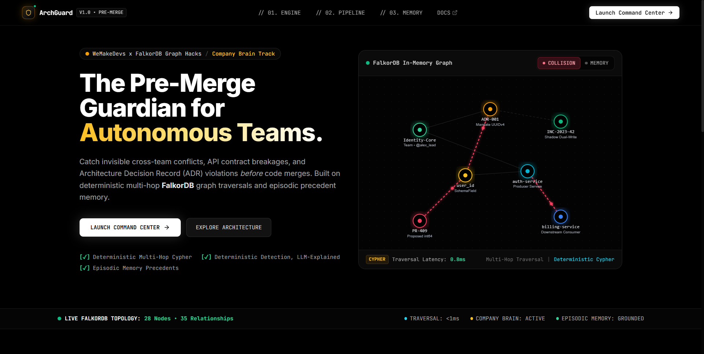
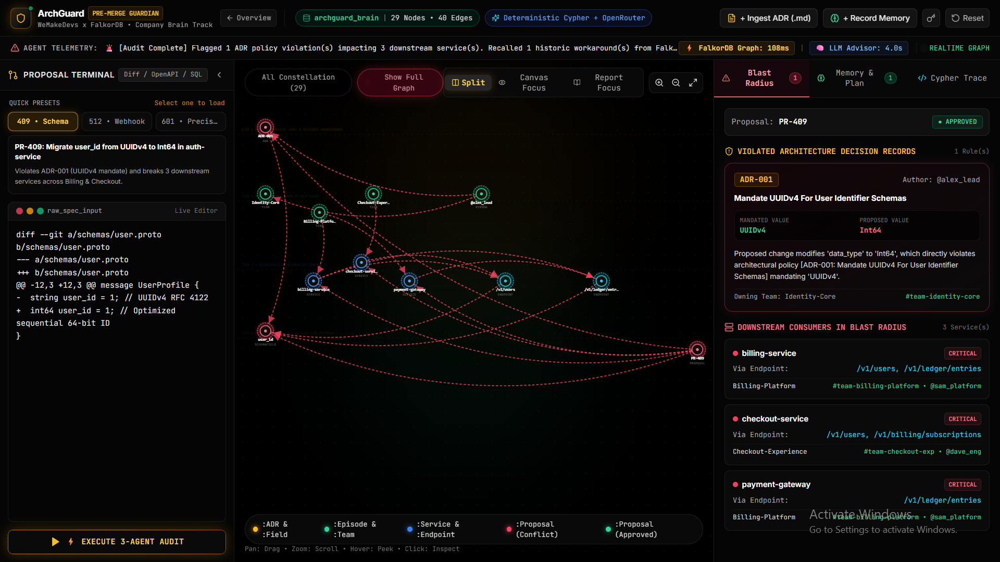

<div align="center">

# 🛡️ ArchGuard

### *The Pre-Merge Architectural Guardian for Autonomous Engineering Teams*

**Powered by FalkorDB Knowledge Graph & Model Context Protocol (MCP)**

[](https://falkordb.com)
[](https://falkordb.com)
[](https://github.com/FalkorDB/FalkorDB)
[](https://www.typescriptlang.org/)
[](LICENSE)
[](https://youtu.be/qKTABIh2Djs)
[](https://dev.to/skfaizan786/why-llm-code-reviewers-fail-at-architecture-and-how-we-fixed-it-with-a-9ms-falkordb-knowledge-graph-144m)

<br/>

<p align="center">
  <em>“Linters check your syntax. ArchGuard protects your architecture.”</em>
</p>

<p align="center">
  
</p>

</div>

---

## 📑 Table of Contents

- [The Core Problem](#-the-core-problem)
- [The Solution: Graph-Mediated Architectural Governance](#-the-solution-graph-mediated-architectural-governance)
- [The 3-Agent Graph-Mediated Architecture](#-the-3-agent-graph-mediated-architecture)
- [The FinCore Domain Knowledge Graph](#-the-fincore-domain-knowledge-graph)
- [Core Capabilities](#-core-capabilities)
- [Interactive FalkorDB Cypher Queries](#-interactive-falkordb-cypher-queries)
- [Quickstart & Local Installation](#-quickstart--local-installation)
- [Live Demo Walkthrough for Judges](#-live-demo-walkthrough-for-judges)
- [Hackathon Track Alignment](#-hackathon-track-alignment)
- [License (MIT)](LICENSE)

---

## 💥 The Core Problem

In modern microservice organizations, architectural decisions are documented in **Architectural Decision Records (ADRs)** and buried in static Markdown repositories, Confluence wikis, or PR comments.

When engineering teams scale or AI coding agents generate dozens of Pull Requests every day, **silent architectural drift** becomes inevitable:

```
                  TRADITIONAL LLM REVIEW BLIND SPOT
                  
  [ Git Diff / PR ] ──► [ Naive LLM Code Reviewer ]
                                 │
                 ┌───────────────┴───────────────┐
                 ▼                               ▼
       Context Window Bloat           Hallucinated Policies
   (Dumping 50 ADRs into prompts     (Invents deprecation rules
    causes attention degradation)     or misses strict mandates)
                 │                               │
                 └───────────────┬───────────────┘
                                 ▼
                     MISSES MULTI-HOP BLAST RADIUS
   Changing user_id from UUIDv4 to Int64 in auth-service silently
   crashes billing-service and checkout-service 3 hops downstream!
```

### Why Naive LLM Reviewers Fail
1. **Context Window Exhaustion:** Shoving 50+ markdown ADRs, 40 OpenAPI schemas, and team ownership rosters into an LLM prompt degrades reasoning accuracy and incurs heavy token costs.
2. **Hallucination vs. Determinism:** Architectural rules are **binary invariants** (e.g., *"All payment schemas MUST use Decimal128"* or *"Auth tokens MUST be UUIDv4"*). LLMs guess; graphs compute.
3. **Missing Transitive Blast Radius:** Static linters analyze single files. They cannot traverse a 3-hop dependency chain: `SchemaField ➔ Service ➔ Downstream Dependency ➔ Endpoint ➔ Team Lead`.
4. **Zero Cross-Session Memory:** When an incident forces a deliberate temporary workaround (e.g., dual-writing during a migration), that knowledge is lost in Slack or Jira. The next PR re-flags the same issue without context.

---

## 💡 The Solution: Graph-Mediated Architectural Governance

**ArchGuard** redefines pre-merge code review by decoupling **deterministic topology traversal** from **probabilistic language synthesis**.

Instead of feeding arbitrary text to an LLM, ArchGuard compiles enterprise architecture into a high-performance **FalkorDB Knowledge Graph** (`archguard_brain`).

```
                    THE ARCHGUARD LATENCY & ACCURACY ADVANTAGE
                    
   ┌────────────────────────────────────────────────────────────────────────┐
   │                          PRE-MERGE PROPOSAL                            │
   │               (Protobuf / OpenAPI / SQL / Git Diff)                    │
   └───────────────────────────────────┬────────────────────────────────────┘
                                       │
                    ┌──────────────────┴──────────────────┐
                    ▼                                     ▼
      ┌───────────────────────────┐         ┌───────────────────────────┐
      │   FalkorDB Graph Engine   │         │    LLM Synthesis Engine   │
      │   Deterministic Cypher    │         │    (Gemini / Groq / GPT)  │
      ├───────────────────────────┤         ├───────────────────────────┤
      │ • Sub-graph Traversal     │         │ • Natural Language Proof  │
      │ • Mathematical Certainty  │         │ • Compliant Spec Diff     │
      │ • Multi-Hop Blast Radius  │         │ • Contextual Remediation  │
      ├───────────────────────────┤         ├───────────────────────────┤
      │      ⚡ LATENCY: <15ms    │         │      ⏱️ LATENCY: ~1.2s    │
      └───────────────────────────┘         └───────────────────────────┘
```

- **FalkorDB does the mathematical heavy lifting:** It executes multi-hop Cypher queries in `<15ms` to locate rule violations, downstream service impacts, and team owner handles.
- **The LLM explains the graph's deterministic proof:** The LLM receives pre-calculated graph facts, completely eliminating hallucinations and context bloat.

<p align="center">
  
</p>

---

## 🤖 The 3-Agent Graph-Mediated Architecture

ArchGuard coordinates three specialized autonomous agents that **communicate strictly through shared state mutations inside FalkorDB**. Agents do not pass conversational prompts to one another; the graph is the single source of truth.

```
                                  ARCHGUARD AGENT PIPELINE
                                  
   Developer PR Diff
          │
          ▼
   ┌──────────────┐   MERGE (:Proposal {id, status:'PARSED'})
   │   AGENT 1    │──────────────────────────────────────────┐
   │SpecExtractor│   CREATE (p)-[:TARGETS_FIELD]->(target)  │
   └──────────────┘                                          ▼
                                                    ┌─────────────────┐
                                                    │    FalkorDB     │
   ┌──────────────┐   MATCH (p)-[:TARGETS_FIELD]-(t)...    │  Company Brain   │
   │   AGENT 2    │◄────────────────────────────────│                 │
   │ GraphAuditor │   MATCH (:ADR)-[:MANDATES]->(t)...     │ 28 Nodes        │
   └──────────────┘                                 │ 35 Relationships│
          │                                         │                 │
          └──────────► CREATE (p)-[:COLLIDES_WITH]->(adr)    │ (Shared State)  │
                       CREATE (p)-[:BREAKS]->(service)      └─────────────────┘
                       SET p.status = 'CONFLICT_DETECTED'    ▲
                                                             │
   ┌──────────────┐   MATCH (adr)<-[:REMEDIES]-(ep:Episode)  │
   │   AGENT 3    │◄─────────────────────────────────────────┘
   │AdvisorMemory │
   └──────────────┘──► Synthesizes remediation diff from historical incident precedents
                       Writes new (:ArchitecturalEpisode) node when workaround is committed
```

### Agent Responsibilities & State Transitions

| Agent | Name | Role | Primary Cypher Action | Output State |
|---|---|---|---|---|
| **Agent 1** | **Spec Extractor** | Parses raw Git diff, protobuf, OpenAPI, or SQL changes and grounds them to concrete schema fields or endpoints. | `MERGE (p:Proposal {id: $id}) CREATE (p)-[:TARGETS_FIELD]->(target)` | `p.status = 'PARSED'` |
| **Agent 2** | **Deterministic Graph Auditor** | Traverses golden ADR invariants and multi-hop dependency chains in `<15ms` to calculate rule collisions and blast radius. | `MATCH (p)-[:TARGETS_FIELD]->(f)<-[:MANDATES]-(a:ADR) CREATE (p)-[:COLLIDES_WITH]->(a), (p)-[:BREAKS]->(s)` | `p.status = 'CONFLICT_DETECTED'` or `'APPROVED'` |
| **Agent 3** | **Episodic Memory Advisor** | Recalls past incident compromises (`:ArchitecturalEpisode`) linked to the violated ADR and generates a verified migration plan. | `MATCH (adr)<-[:REMEDIES]-(ep:ArchitecturalEpisode) RETURN ep` | Compliant Diff & Precedent Recall |

---

## 🌐 The FinCore Domain Knowledge Graph

The default graph represents **FinCore Financial Systems**, an enterprise-grade multi-tier fintech architecture seeded directly into FalkorDB:

```
                           FINCORE ARCHITECTURE TOPOLOGY
                           
      [ ADR-001: UUIDv4 ]             [ ADR-002: Async Webhooks ]        [ ADR-003: Decimal128 ]
              │                                    │                                 │
       [:ENFORCES]                            [:GOVERNS]                        [:MANDATES]
              ▼                                    ▼                                 ▼
    (user_id: SchemaField)              (/v1/webhooks/payment)              (amount: SchemaField)
              │                                    │                                 │
        [:DEFINED_IN]                         [:EXPOSED_BY]                     [:DEFINED_IN]
              ▼                                    ▼                                 ▼
      [ auth-service ]                      [ payment-gateway ]              [ ledger-service ]
              ▲                                    │                                 ▲
              │ [:CALLS]                           │ [:DEPENDS_ON]                   │ [:CALLS]
      [ checkout-service ] ◄───────────────────────┘                         [ billing-service ]
              │                                                                      │
         [:OWNED_BY]                                                            [:OWNED_BY]
              ▼                                                                      ▼
      { Team: Checkout }                                                     { Team: Billing }
              ▲                                                                      ▲
         [:LEADS]                                                               [:LEADS]
      (@dave_eng: Person)                                                   (@elena_fin: Person)
```

### Canonical Baseline Statistics (Pristine Database)

| Category | Node Label | Count | Sample Entities | Relationship Types |
|---|---|:---:|---|---|
| 🟡 **Golden Rules** | `:ADR` | **4** | `ADR-001` (UUIDv4), `ADR-002` (Async Webhook), `ADR-003` (Decimal128), `ADR-004` (Idempotency) | `[:MANDATES]`, `[:ENFORCES]`, `[:GOVERNS]` |
| 🟡 **Data Contracts** | `:SchemaField` | **3** | `user_id`, `amount`, `order_status` | `[:DEFINED_IN]` |
| 🟢 **Organization** | `:Team` | **4** | `Auth Team`, `Billing Team`, `Checkout Team`, `Platform Team` | `[:OWNED_BY]` |
| 🟢 **Key Personnel** | `:Person` | **5** | `@alice_arch`, `@bob_lead`, `@charlie_dev`, `@dave_eng`, `@elena_fin` | `[:LEADS]` |
| 🔵 **Services** | `:Service` | **5** | `auth-service`, `billing-service`, `checkout-service`, `ledger-service`, `payment-gateway` | `[:CALLS]`, `[:DEPENDS_ON]` |
| 🔵 **Endpoints** | `:Endpoint` | **5** | `/v1/auth/login`, `/v1/checkout/charge`, `/v1/webhooks/payment`, `/v1/ledger/record`, `/v1/billing/invoice` | `[:EXPOSES]` |
| 🧠 **Episodic Memory** | `:ArchitecturalEpisode` | **2** | `INC-2023-42` (Legacy Billing integer workaround), `INC-2023-88` (Webhook sync outage workaround) | `[:REMEDIES]`, `[:APPROVED_BY]` |
| **TOTALS** | **7 Labels** | **28 Nodes** | **35 Relationships** | **100% Deterministic Schema** |

---

## ⚡ Core Capabilities

### 1. Deterministic Multi-Hop Collision Detection
When a PR proposes changing `user_id` from `UUIDv4` to `Int64`, ArchGuard traverses the graph to prove:
- **Direct ADR Violation:** Violates `ADR-001` (*"Canonical User Identification Standard"*).
- **Transitive Blast Radius:** `auth-service` exposes `user_id` ➔ `billing-service` and `checkout-service` ingest it ➔ Breaking 3 downstream microservices.
- **Human Invariant Notification:** Identifies the exact Tech Leads to ping (`@bob_lead`, `@dave_eng`, `@elena_fin`).

### 2. Live Markdown ADR Ingestion (`+ Ingest ADR (.md)`)
Upload or paste any markdown ADR with YAML frontmatter. ArchGuard extracts its mandates, links it to target entities, and updates the FalkorDB topology in real time without restarting the server.

### 3. Cross-Session Episodic Memory Learning (`+ Record Memory`)
When teams agree on an architectural compromise or workaround during an outage:
- Developer commits an `:ArchitecturalEpisode` node containing:
  - Incident ID (e.g. `INC-2026-99`)
  - Remediation pattern & temporary migration steps
  - Technical trade-offs & approval author
- **Cross-Session Recall:** Any subsequent PR violating the same ADR immediately surfaces this historical compromise, preventing teams from having the same argument twice.

### 4. Interactive Pitch-Black Constellation Canvas
- Custom WebGL/SVG canvas built with a dark Linear/Resend aesthetic.
- **Auto-Isolating Collision Mode:** Focuses exclusively on the sub-graph involved in the conflict (`Proposal ➔ Target ➔ Violated ADR ➔ Downstream Services`).
- **One-Click View Modes:** Instant toggle between `Split View` (3-pane cockpit), `Canvas Focus` (full-screen graph), and `Executive Report` (side-by-side audit report).

### 5. Multi-Provider LLM Engine with Heuristic Fallback
- Supports **Google Gemini 2.5 Pro / Flash**, **Groq Llama 3.3 70B**, and **OpenAI GPT-4o**.
- **Bulletproof Offline Fallback:** If API keys are missing or LLM rate limits are hit, ArchGuard automatically engages its rule-based heuristic engine. **The demo will never crash on stage.**

---

## 🔍 Interactive FalkorDB Cypher Queries

ArchGuard runs these exact Cypher queries against FalkorDB:

### 1. Detect ADR Violations from Proposed Change
```cypher
MATCH (p:Proposal {id: $proposalId})-[r:TARGETS_FIELD]->(target)
MATCH (adr:ADR)-[m:MANDATES|ENFORCES|GOVERNS]->(target)
WHERE r.proposed_value <> m.required_format
MERGE (p)-[c:COLLIDES_WITH {detected_at: datetime()}]->(adr)
SET p.status = 'CONFLICT_DETECTED'
RETURN adr.code, adr.title, m.required_format, r.proposed_value;
```

### 2. Multi-Hop Downstream Consumer Blast Radius
```cypher
MATCH (target)<-[:DEFINES|EXPOSES]-(origin:Service)
MATCH (origin)<-[:CALLS|DEPENDS_ON*1..2]-(downstream:Service)
OPTIONAL MATCH (downstream)-[:OWNED_BY]->(team:Team)<-[:LEADS]-(lead:Person)
RETURN downstream.name AS broken_service,
       team.name AS team,
       lead.handle AS tech_lead;
```

### 3. Recall Historical Episodic Memory Precedents
```cypher
MATCH (adr:ADR {code: $violatedAdrCode})<-[:REMEDIES]-(ep:ArchitecturalEpisode)
OPTIONAL MATCH (ep)-[:APPROVED_BY]->(lead:Person)
RETURN ep.incident_id AS incident,
       ep.title AS title,
       ep.workaround_pattern AS solution,
       ep.trade_offs AS trade_offs,
       lead.handle AS approver;
```

---

## 🚀 Quickstart & Local Installation

### Prerequisites
- [Docker & Docker Compose](https://www.docker.com/)
- [Node.js v18+](https://nodejs.org/)
- [Git](https://git-scm.com/)

### Step 1: Clone the Repository
```bash
git clone https://github.com/SKfaizan-786/ArchGuard.git
cd ArchGuard
```

### Step 2: Configure Environment Variables
```bash
cp .env.example .env
```
*(Optional: Add your `GEMINI_API_KEY`, `OPENROUTER_API_KEY`, or `OPENAI_API_KEY`. If left empty, ArchGuard's deterministic fallback engine takes over seamlessly.)*

### Step 3: Launch FalkorDB via Docker
```bash
docker compose up -d
```
*FalkorDB will be listening on port `6379` (Redis protocol) and port `3000` (FalkorDB Web Browser).*

### Step 4: Install Dependencies & Run Full-Stack
```bash
# Install root dependencies
npm install

# Install frontend dependencies
npm --prefix client install

# Launch backend and frontend concurrently
npm run dev:all
```

- **Frontend Command Center:** Open [http://localhost:5173](http://localhost:5173)
- **Backend Express API:** Open [http://localhost:4000/api/health](http://localhost:4000/api/health)
- **FalkorDB Visual Browser:** Open [http://localhost:3000](http://localhost:3000)

---

## 🎬 Live Demo Walkthrough for Judges

> 📺 **Watch the Full Video Walkthrough on YouTube:** [https://youtu.be/qKTABIh2Djs](https://youtu.be/qKTABIh2Djs)

Follow this 90-second script to experience the full power of ArchGuard:

1. **Verify Baseline State:**
   - Look at the top navigation bar. It confirms: `28 Nodes • 35 Edges`.
2. **Execute Audit on Preset 1 (PR-409):**
   - Click the preset button **`409 • Schema`** (Migrate `user_id` from UUIDv4 to Int64).
   - Click **`Run 3-Agent Audit`**.
   - **Observe:**
     - The canvas instantly isolates the collision path in glowing crimson.
     - Agent 1 registers `:Proposal (PR-409)`.
     - Agent 2 proves a direct violation of `ADR-001` and highlights the 3 downstream broken services (`billing-service`, `checkout-service`, `ledger-service`).
     - Agent 3 recalls `INC-2023-42` from FalkorDB episodic memory and synthesizes a compliant dual-write migration strategy.
3. **Inspect the Cypher Trace:**
   - Click the **`Cypher Trace`** tab in the right pane to see real-time query timings (`<15ms` execution).
4. **Demonstrate Compliant Pass (PR-601 or Code Fix):**
   - In the diff editor, change `int64 user_id = 1;` back to `string user_id = 1; // UUIDv4 RFC 4122`.
   - Re-run the audit.
   - **Observe:** The proposal node glows vibrant emerald (`:Proposal (Approved)`), status badges switch to `APPROVED_PRE_MERGE`, and blast radius drops to **0**.
5. **Demonstrate Live Ingestion:**
   - Click **`+ Ingest ADR`** in the top bar. Paste a new Markdown ADR rule (e.g., `ADR-006: Strict GraphQL Nullability`).
   - Click **`Compile into FalkorDB Brain`**.
   - Watch the total node count increment live.
6. **Reset to Pristine Baseline:**
   - Click **`Reset Graph`** to return the database to its pristine 28-node baseline state.

---

## 🏆 Hackathon Track Alignment

### Track: Company Brain & Episodic Memory

| Track Requirement | ArchGuard Implementation |
|---|---|
| **Organizational Knowledge Graph** | Models company invariants, team topologies, microservices, endpoints, schemas, and ADR rules in a unified FalkorDB graph. |
| **Episodic Memory Retention** | Persists historical incidents and approved workarounds (`:ArchitecturalEpisode`) with approval lineage (`@sarah_arch`, `@bob_lead`). |
| **Multi-Agent Coordination** | 3 autonomous agents coordinate through FalkorDB graph mutations rather than fragile prompt chaining. |
| **Performance & Latency** | Replaces heavy LLM RAG pipelines with sub-15ms deterministic Cypher traversals. |
| **Developer Experience** | Linear-grade dark constellation UI, multi-format input (Diff / OpenAPI / Protobuf / SQL), and seamless Docker deployment. |

---

## 📄 License & Team

This project is licensed under the **MIT License** — see the [LICENSE](LICENSE) file for details.

- 📖 **Technical Deep-Dive on Dev.to:** [Why LLM Code Reviewers Fail at Architecture—And How We Fixed It with a 9ms FalkorDB Knowledge Graph](https://dev.to/skfaizan786/why-llm-code-reviewers-fail-at-architecture-and-how-we-fixed-it-with-a-9ms-falkordb-knowledge-graph-144m)
- 🎥 **YouTube Demo Walkthrough:** [https://youtu.be/qKTABIh2Djs](https://youtu.be/qKTABIh2Djs)

Built with ❤️ by SK Faizanuddin for the **WeMakeDevs x FalkorDB "Graph Hacks" Hackathon** (Company Brain & Episodic Memory Track).
