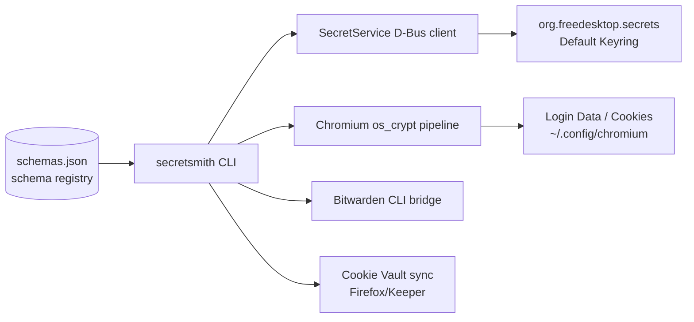

# secretsmith

[](https://github.com/toxicwind/ranch)
[](tests/)
[](https://www.python.org/)
[](#license--security)
[](https://specifications.freedesktop.org/secret-service/latest/)

> 🗺️ Part of [**the ranch**](https://github.com/toxicwind/ranch) — the whole inference estate, one map.

**One CLI for every secret on the box.** Freedesktop Secret Service, Chromium
`os_crypt` keyring, Bitwarden, and the Firefox/Keeper cookie vault — unified,
scriptable, and safe by default. Secrets are never printed without `--show`;
nothing ever passes through argv.

Born from a real bug: a Chromium `os_crypt` key lookup filtered on
`xdg:schema org.freedesktop.Secret.Generic` — a schema Chromium never uses —
and came back empty. `secretsmith` makes that impossible: default search has no
schema filter, and `--schema` resolves through the known-schema registry
(`schemas.json`).

Fork lineage: [GNOME/libsecret](https://github.com/GNOME/libsecret)
(`secret-tool`), forked to [toxicwind/libsecret](https://github.com/toxicwind/libsecret)
— this tool reimplements and maximalizes `secret-tool`'s D-Bus semantics in Python.

## Features

- **Everything is a target** — D-Bus Secret Service items, Chromium
  logins/cookies/keys, Bitwarden (`bw-get`), cookie vault (`cookie-vault`)
- **Search that can't silently miss** — no schema filter by default; free-text
  positional query over labels + attributes; exact `--label` selector
- **Flags where you type them** — `--show`/`--json`/`--bus` work *before or
  after* the subcommand
- **Safe by default** — redacted output, stdin-only secret intake, two-step
  delete, prompt-aware unlock waits
- **JSON mode for everything** — pipe any command into `jq`

## Architecture



## Quick Start

```bash
# install (single file + launcher)
ln -sf /home/toxic/estate/ranch/barn/secretsmith/bin/secretsmith ~/.local/bin/secretsmith

# deps: python3, dbus-python, cryptography (Chromium pipeline only)
secretsmith check          # all green = service up, keyring unlocked, Chromium readable

# roundtrip
echo -n "s3cr3t" | secretsmith set --label "my api key" --attr service=example
secretsmith get --label "my api key" --show
secretsmith search example
secretsmith delete --label "my api key" --yes
```

## Usage

```bash
# health: service reachable, default collection unlocked, Chromium entry readable
secretsmith check

# search everything (no schema filter — the original bug is impossible)
secretsmith search --attr application=chromium
secretsmith search github            # free-text: matches label + attributes
secretsmith search --label "my api key"

# schema-aware search via the registry
secretsmith search --schema chromium
secretsmith search --schema generic --attr foo=bar

# get exactly one item (errors on 0 or >1 matches)
secretsmith get --attr xdg:schema=org.freedesktop.Secret.Generic --show
secretsmith get --label "my api key" --show     # --show works after the subcommand
secretsmith --json get --label "my api key"     # ...and before it

# store (secret from stdin or --secret-file; never from argv)
echo -n "s3cr3t" | secretsmith set --label "my api key" --attr service=example
secretsmith set --label k --attr service=ex --secret-file /run/key --replace

# delete (two-step unless --yes)
secretsmith delete --attr service=example --yes
secretsmith delete --label "my api key" --yes

# collections
secretsmith collections
secretsmith collection-create ops --alias default
secretsmith lock default / unlock default

# registry
secretsmith schemas

# Chromium/Chrome os_crypt pipeline (the use case that started this)
secretsmith chromium-key                 # key lookup via registry (byte count)
secretsmith chromium-key --show          # print base64 key
secretsmith chromium-logins              # decrypt ~/.config/chromium/Default/Login Data
secretsmith chromium-logins --profile-dir /path/to/profile --show
secretsmith chromium-cookies

# Bitwarden integration (first-class vault resolution)
secretsmith bw-status                      # check Bitwarden CLI vault status
secretsmith bw-get password github         # retrieve password (Secret Service fallback)
secretsmith --json bw-status

# Cookie Vault integration (Firefox & Keeper session synchronization)
secretsmith cookie-vault sync              # sync live Firefox cookies into keeper vault
secretsmith cookie-vault status            # report stored cookies & domains

# JSON mode for everything (scriptable)
secretsmith --json search --schema chromium
```

## Configuration

| Thing | Where | Notes |
|---|---|---|
| D-Bus address | `--bus` or `$DBUS_SESSION_BUS_ADDRESS` | launcher defaults to `/run/user/<uid>/bus` |
| Schema registry | `schemas.json` | friendly names → `xdg:schema`; `chrome` aliases `chromium`; unregistered schemas work but warn |
| Keyring | GNOME Keyring / `org.freedesktop.secrets` | must be unlocked for secret reads (CLI waits ≤15 s for unlock) |
| Chromium profiles | `~/.config/chromium` | override with `--profile-dir` |

## Development

```bash
python3 -m unittest discover -s tests -v          # unit tests (no keyring needed)
SSM_TEST_KEYRING=1 python3 -m unittest discover -s tests -v   # + live D-Bus integration
```

The integration test creates a throwaway collection, round-trips an item, and
deletes the collection.

```text
secretsmith/
├── secretsmith.py   # the CLI (single file)
├── schemas.json     # known-schema registry
├── bin/secretsmith  # launcher (PATH install target)
├── tests/test_secretsmith.py
├── tests/test_secretsmith_integrations.ts
└── README.md
```

## Compat shim

`compat-chromium-keyring.sh` is the source of the old
`/home/toxic/.local/bin/chromium-keyring` stopgap, now a thin shim over
secretsmith (`check` → `secretsmith check`, `attrs` →
`secretsmith search --schema chromium`, `key` → `secretsmith chromium-key --show`).
One truth lives in secretsmith; the shim exists for muscle memory only.

## License & Security

MIT, same lineage as the libsecret fork it replaces.

Security posture: secrets never printed without `--show`; listings show
`<redacted: N bytes>`; binary secrets print as base64 only under `--show`;
secret intake is stdin/`--secret-file` only (no `ps`-visible argv); deletes are
two-step unless `--yes`; the schema-registry warning exists so a mistyped
schema can never silently narrow a search. Report leaks to the estate owner —
do not file public issues containing secret material.
