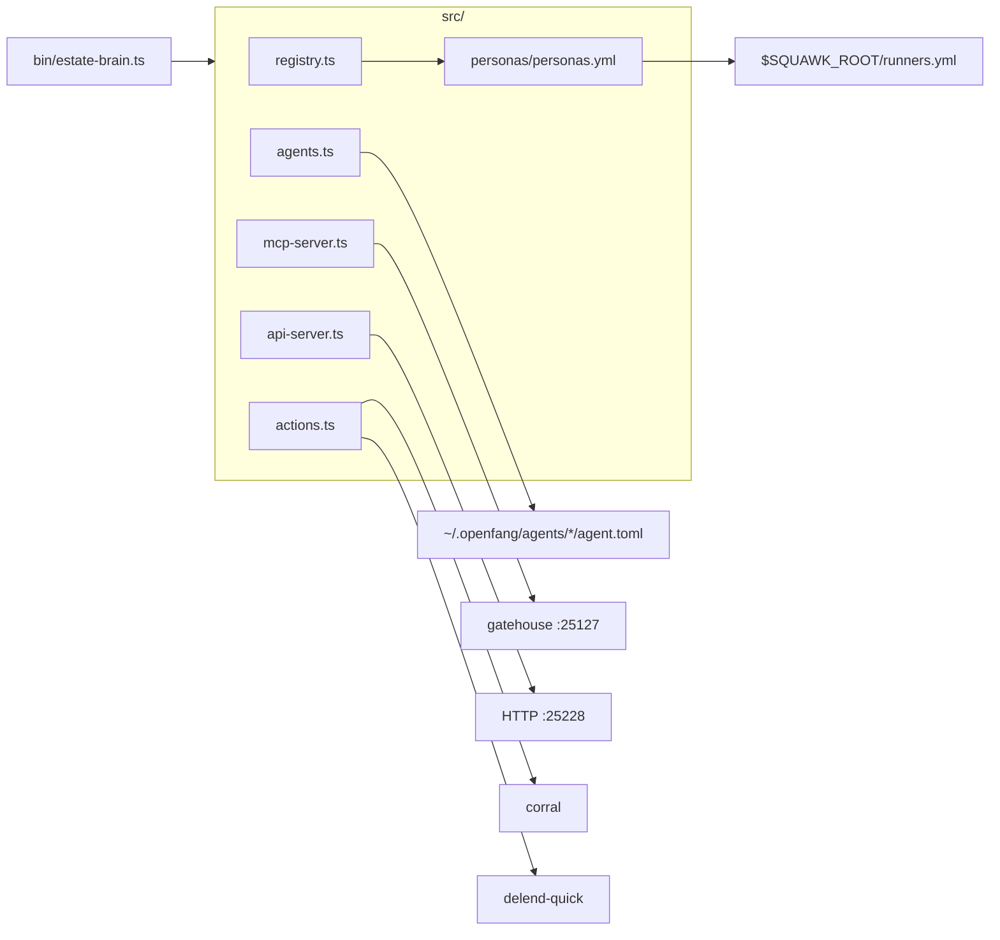

<div align="center">

# estate-brain

**The fleet's single source of truth** for crew rosters, personas, signing
identities, keys, tokens, and Rig agent mirrors — with a CLI, MCP drop-in, and
HTTP API, and full Corral + Delend integration.

[](https://github.com/toxicwind/ranch#license)
[](https://bun.sh)
[](https://modelcontextprotocol.io)
[](<>)
[](<>)

_everyone knows who everyone is, what they own, and how they sign_

</div>

---

## Why you should care

Until now the estate's identities were scattered across **three overlapping
systems**: a `squawk-persona` key/token registry, a `crews` roster + persona
folders, and an `agents` directory of Rig launch configs. They comped, dupe'd,
and drifted. This repo is the **one home** they all consolidated into — so any
agent, runner, or crew can:

- resolve **its own** signing identity, key, token, and channels
- read the whole roster (who owns what lane) and the persona registry
- **rig and work itself** — every agent has a canonical `agent.toml` mirror
- **drive Corral** orchestration and **Delend** checkpoints under its own name

## Feature bullets

- **One registry, 46 personas** — runner profiles, crew identities, named keys,
  and all 21 Rig agents, validated by Zod.
- **Three surfaces, one engine** — a Bun CLI, an MCP drop-in (R-101…R-304
  compliant), and a local HTTP API all wrap the same `src/` logic.
- **Full squawk integration** — `gen-runners` regenerates `$SQUAWK_ROOT/
runners.yml`, so `squawk --profile` always matches the registry.
- **Rig mirrors** — every agent's `agent.toml` is canonicalized here and
  deployable to the live OpenFang run dir.
- **Corral & Delend for everyone** — any persona can orchestrate and checkpoint
  as itself; secrets never printed.
- **No secrets in git** — token _paths_ only, `.gitignore` excludes `*.key`.

## Quick start

```bash
bun install
bun bin/estate-brain.ts list          # the 46-persona roster
bun bin/estate-brain.ts gen-runners   # publish to your squawk root
bun bin/estate-brain.ts validate      # keys + tokens resolve?
```

## Architecture

```
personas/
  personas.yml         <- THE registry (SSOT) — 46 personas
  <name>/              <- per-identity files (IDENTITY/SOUL/MEMORY/AGENTS)
  roster.json          <- machine-readable crew roster
agents/<name>/         <- 21 canonical agent.toml (Rig mirrors) + gen_toml.py
roster/*.md            <- 140 per-crew ownership & status records
docs/identity-specs/   <- keygen, key-rotation, squawk-verification
src/                   <- Bun engine (registry, actions, agents, MCP, API)
bin/                   <- the CLI entries
tests/                 <- unit tests (registry, render, keygen)
```



## CLI reference

| Command                    | Purpose                                                        |
| -------------------------- | -------------------------------------------------------------- |
| `list`                     | profile table (46 personas)                                    |
| `show <p>` / `resolve <p>` | one persona's detail / JSON resolution                         |
| `env <p>`                  | source-able exports (`FLEET_KEYS_DIR`, `SQUAWK_SENDER`, token) |
| `keygen <p>`               | ensure a signing key exists (0600)                             |
| `gen-runners --root R`     | regenerate `R/runners.yml` for squawk                          |
| `validate`                 | registry + every key/token path resolves                       |
| `agents`                   | list Rig agent configs, bound to personas                      |
| `deploy --live-dir R`      | mirror `agent.toml` → OpenFang run dir                         |
| `corral <p> -- <cmd>`      | run Corral orchestration as persona `<p>`                      |
| `checkpoint <p> -m <msg>`  | Delend checkpoint + push as persona `<p>`                      |
| `keys-dir`                 | print the resolved keys dir                                    |

`bin/squawk-persona` is a back-compat alias for the same CLI.

### MCP drop-in

`src/mcp-server.ts` exposes 10 tools (`brain_list`, `brain_show`, `brain_resolve`,
`brain_agents`, `brain_validate`, and the mutating `brain_keygen`,
`brain_gen_runners`, `brain_deploy`, `brain_corral`, `brain_checkpoint`).
Follows the estate mcp-dropin-guide (Content-Length framing, dual-framed input,
`2024-11-05` initialize, schemas with descriptions, mutating ⇒ `confirm:true`).
Run it with `bun src/mcp-server.ts` and register it in gatehouse
`mcp_config.json`.

### HTTP API

`src/api-server.ts` listens on `127.0.0.1:25228` (override `ESTATE_BRAIN_PORT`):

```
GET  /health  /personas  /personas/:name  /agents  /roster  /specs
POST /keygen {persona,confirm}   /gen-runners {confirm}  /deploy {confirm}
POST /corral {persona,args,confirm}  /checkpoint {persona,message,confirm}
```

Mutating endpoints require `confirm: true`. Secrets never returned — only paths.

## Configuration

- `FLEET_KEYS_DIR` — where signing keys live (default `~/.fleet-bus/keys`).
- `ESTATE_BRAIN_BIN` / `ESTATE_BRAIN_BUN` — MCP server spawn overrides.
- `ESTATE_BRAIN_PORT` — HTTP API port (default 25228).
- `ESTATE_BRAIN_HELD` — set truthy to bind all interfaces (default loopback).
- `CORRAL_BIN`, `DELEND_BIN` — orchestration/checkpoint binaries.
- `SQUAWK_ROOT` — squawk root (default `~/.fleet-bus/squawk-root`).

## Development

```bash
bun run validate    # typecheck + coverage + lint
bun test            # unit tests
# NOTE: run these with `RUN_FAST_ACTIVE=1` to bypass the estate 2s shim.
```

## Security

Signing keys and token values never enter this repo. `personas/personas.yml`
stores token **paths** only; `.gitignore` excludes `*.key`. The MCP server and
HTTP API surface paths, never secret values, and gate every mutation behind
`confirm:true`.

## License & acknowledgments

MIT where marked. Built against the estate's mcp-dropin-guide and
squawk/corral/delend conventions; consolidated from `squawk-persona`,
`estate/crews`, and `estate/agents` (2026-10-22).
