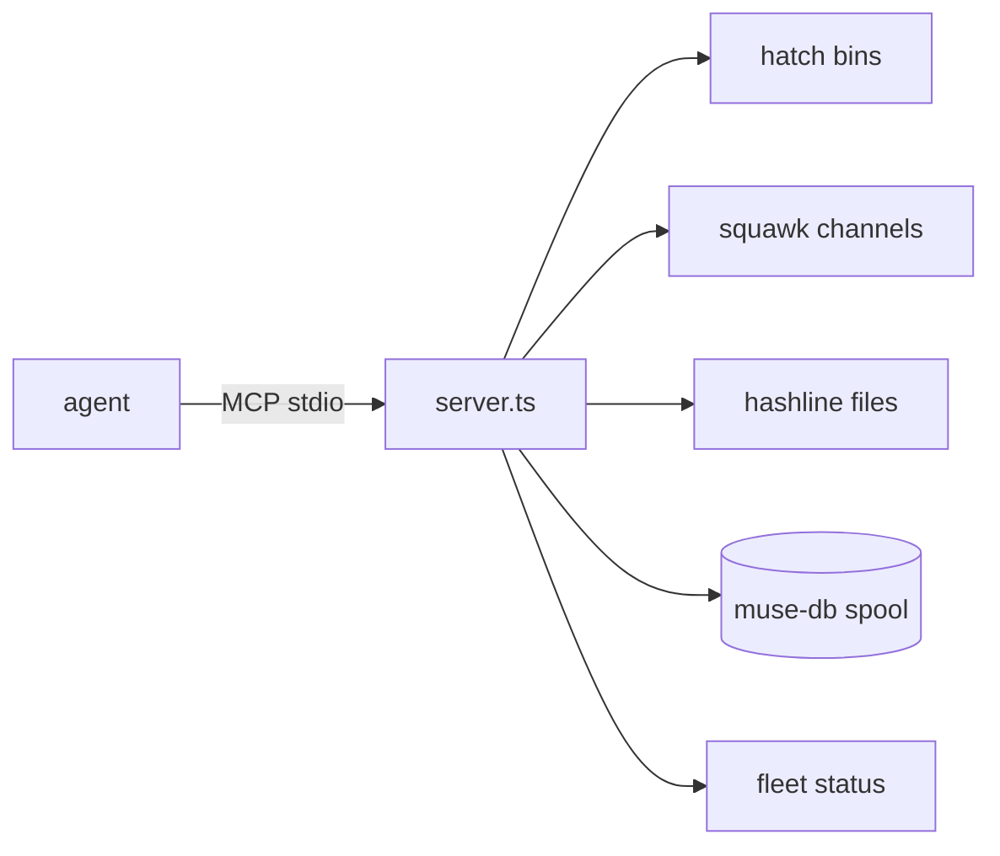

<div align="right">

[](LICENSE)
[](https://github.com/toxicwind/fleet-bus-mcp)
[](https://bun.sh)

</div>

# fleet-bus-mcp

Fleet bus telemetry for agents over MCP stdio — hatch status, squawk channels,
hashline reads, muse-db spool queries, and fleet status in one server.

Part of the [estate](https://github.com/toxicwind/estate) control plane:
the fleet runs 90+ pitchfork daemons; this server is how an agent asks
"what's the load, what's squawking, what changed" without shelling out.



## Tools

| Tool | Description |
| --- | --- |
| `hatch_status` | Hatch runtime status |
| `hatch_load_audit` | Hatch load audit trail |
| `squawk_list_channels` | List active squawk channels |
| `squawk_read` | Read messages from a channel |
| `squawk_send` | Send a message to a channel |
| `muse_db_query` | Query the muse-db spool |
| `hashline_read` | Read a file through hashline |
| `fleet_status` | Fleet-wide daemon status |

## Run

```bash
bun run server.ts
```

Stdio MCP transport. Newline-delimited JSON-RPC out; accepts both
Content-Length and newline framing in.

## Environment

| Var | Default | Purpose |
| --- | --- | --- |
| `HATCH_BIN` | `/home/toxic/hatch/bin` | Hatch binaries dir |
| `HASHLINE_BIN` | `~/.local/bin/hashline` | Hashline CLI |
| `SQUAWK_ROOT` | `~/.fleet-bus/squawk-root` | Squawk channel root |
| `MUSE_DB_SPOOL` | `~/.muse-db-shim` | Muse-db spool dir |

## Architecture

Single-file Bun server (`server.ts`). Every tool is a thin, audited
subprocess call with a hard timeout — the server holds no state and
never writes outside its declared roots.

## Related

- [hatch-mcp](https://github.com/toxicwind/hatch-mcp) — superset sibling with audit + hashline patch
- [estate](https://github.com/toxicwind/estate) — control plane this serves

## License

MIT — see [LICENSE](LICENSE).
