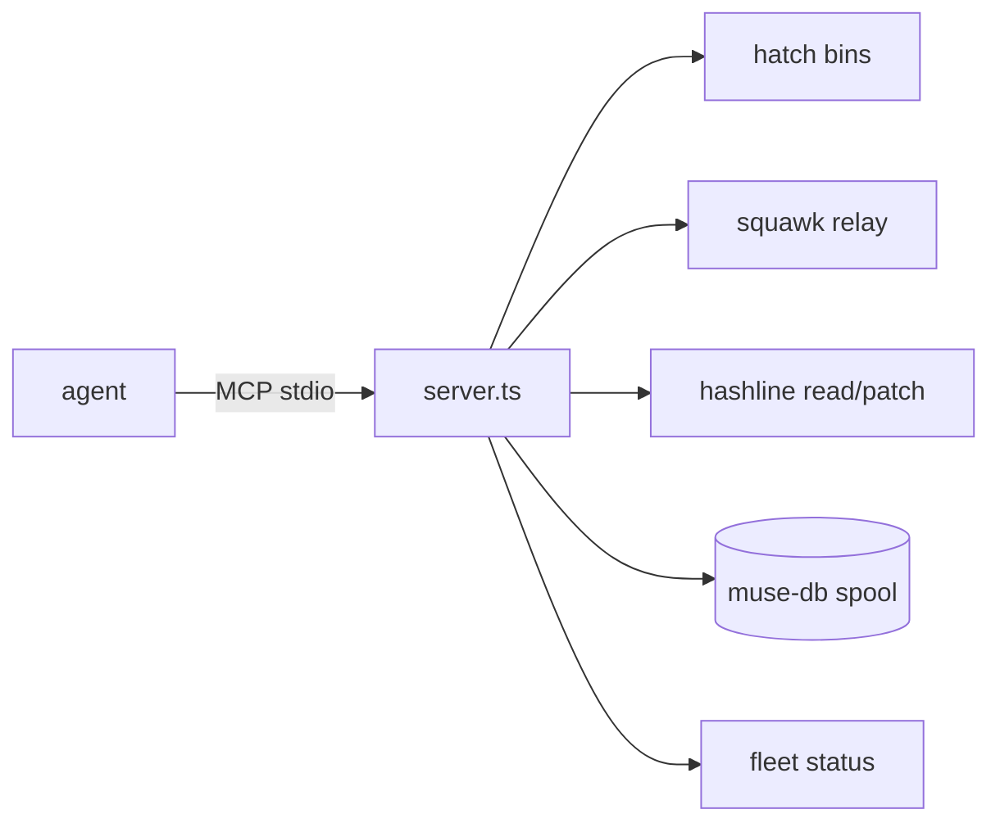

<div align="right">

[](LICENSE)
[](https://github.com/toxicwind/hatch-mcp)
[](https://bun.sh)

</div>

# hatch-mcp

Hatch control-cell MCP server — status, load audits, squawk relay,
muse-db queries, and hashline read/patch over MCP stdio.

The hatch sidecar behind the [estate](https://github.com/toxicwind/estate)
control plane: agents get structured reads of what the hatch is running,
what it audited, and safe hashline patches — without raw shell.



## Tools

| Tool | Description |
| --- | --- |
| `hatch_status` | Hatch runtime status |
| `hatch_load_audit` | Load audit trail for the hatch |
| `squawk_list_channels` | List active squawk channels |
| `squawk_read` | Read messages from a channel |
| `squawk_send` | Send a message to a channel |
| `muse_db_query` | Query the muse-db spool |
| `hashline_read` | Read a file through hashline |
| `hashline_patch` | Apply a hashline patch (DESTRUCTIVE-GATED) |
| `fleet_status` | Fleet-wide daemon status |
| `hatch_bin_list` | List hatch binaries |

## Run

```bash
bun run server.ts
```

Stdio MCP transport. Newline-delimited JSON-RPC out; accepts both
Content-Length and newline framing in.

## Environment

| Var | Default | Purpose |
| --- | --- | --- |
| `HATCH_BIN` | `/home/toxic/hatch/bin` | Hatch binaries dir |
| `HASHLINE_BIN` | `~/.local/bin/hashline` | Hashline CLI |
| `SQUAWK_ROOT` | `~/.fleet-bus/squawk-root` | Squawk channel root |
| `MUSE_DB_SPOOL` | `~/.muse-db-shim` | Muse-db spool dir |

## Safety

`hashline_patch` is the only mutating tool and requires explicit
confirmation in the tool call — pattern-match on the gatehouse
DESTRUCTIVE-GATED convention.

## Related

- [fleet-bus-mcp](https://github.com/toxicwind/fleet-bus-mcp) — read-mostly sibling
- [estate](https://github.com/toxicwind/estate) — control plane this serves

## License

MIT — see [LICENSE](LICENSE).
