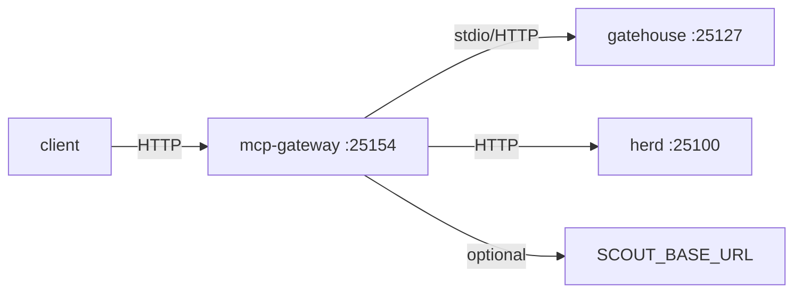

<div align="right">

[](LICENSE)
[](https://github.com/toxicwind/mcp-gateway)
[](https://bun.sh)

</div>

# mcp-gateway

HTTP MCP aggregator in front of the estate's MCP proxies — one HTTP
endpoint (`/mcp`) that fans tools/list and tools/call out to gatehouse
(:25127) and herd (:25100), plus `/health` for load balancers.



## Endpoints

| Path | Method | Description |
| --- | --- | --- |
| `/health` | GET | Returns `ok` — liveness probe |
| `/mcp` | POST | MCP JSON-RPC: tools/list and tools/call fanned out |
| anything else | — | 404 |

## Run

```bash
bun run src/index.ts
# MCP_GATEWAY_PORT=25154 by default
```

## Environment

| Var | Default | Purpose |
| --- | --- | --- |
| `MCP_GATEWAY_PORT` | `25154` | Listen port (25155 belongs to NativeLink — do not reuse) |
| `SCOUT_BASE_URL` | unset | Optional third backend |

## Note

`src/gateway.ts` (the `McpGateway` fan-out) is the active work item —
it wires the upstreams listed above into the `/mcp` handler. The
thin `index.ts` currently boots the server shell.

## License

MIT — see [LICENSE](LICENSE).
