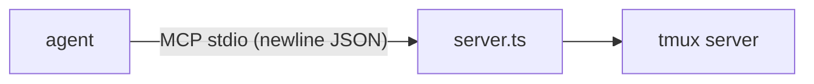

<div align="right">

[](LICENSE)
[](https://github.com/toxicwind/tmux-mcp)
[](https://bun.sh)

</div>

# tmux-mcp

Drive tmux sessions from any MCP client — list, capture, and send keys
with proper stdio framing. Single-file Bun server, zero dependencies.

**Why this fork exists**: the original emitted Content-Length-framed
JSON-RPC only. Gatehouse's (mcpproxy-go) stdio path silently ignores
Content-Length-only peers — zero tools discovered. This fork emits
newline-delimited JSON-RPC (one object per line) and accepts **both**
framings on input for backward compatibility. See the framing note in
`server.ts`.



## Tools

| Tool | Description |
| --- | --- |
| `tmux_list` | List tmux sessions/windows/panes |
| `tmux_capture` | Capture a pane's visible text |
| `tmux_send` | Send keys/text to a pane |

## Run

```bash
bun run server.ts
```

Stdio MCP transport, newline-delimited JSON-RPC out; accepts both
Content-Length and newline framing in. Framing is auto-detected per
message: a leading `Content-Length:` header selects header framing,
anything else parses line-by-line.

## Testing

Handshake proven: initialize + tools/list + a real `tmux_list` against
the gatehouse proxy (which drops Content-Length-only peers).

## License

MIT — see [LICENSE](LICENSE).
