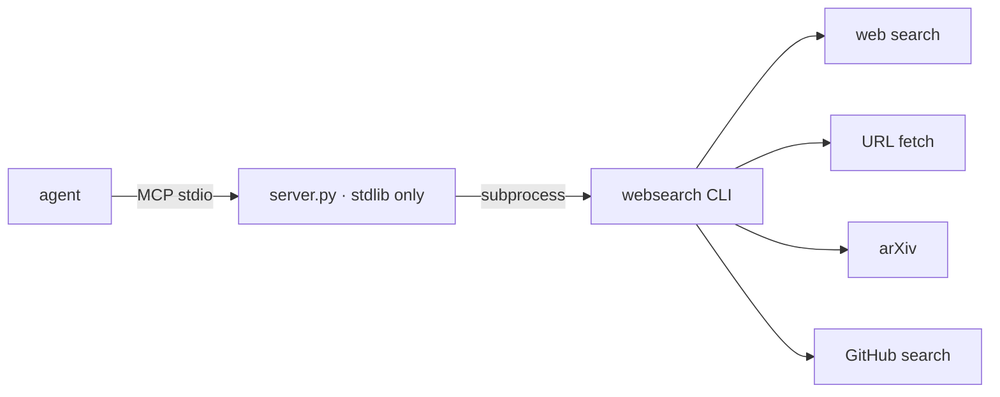

<div align="right">

[](LICENSE)
[](https://github.com/toxicwind/websearch-mcp)
[](https://www.python.org)

</div>

# websearch-mcp

Stdlib-only MCP wrapper for the [`websearch-skill`](https://pypi.org/project/websearch-skill/)
CLI (v0.6.1). The CLI ships no MCP server — this fork exposes its capabilities
over MCP stdio using only the Python standard library: no extra dependencies,
nothing to install.



## Tools

| Tool | Description |
| --- | --- |
| `web_search` | Web search via `websearch web-search --json` |
| `web_fetch` | Fetch a URL via `websearch web-fetch --json` |
| `arxiv_search` | arXiv search |
| `github_search` | GitHub code/repo search |

## Run

```bash
python3 server.py
```

Requires the `websearch` CLI on PATH (`uvx websearch-skill` provides it).

## Architecture

One Python file (`server.py`), stdlib only. MCP stdio framing in,
CLI subprocess out — the wrapper adds the protocol, not the capability.

## Testing

Live-tested 2026-09-20: initialize + tools/list + real `web_search` for
"Model Context Protocol" returned live results.

## License

MIT — see [LICENSE](LICENSE).
