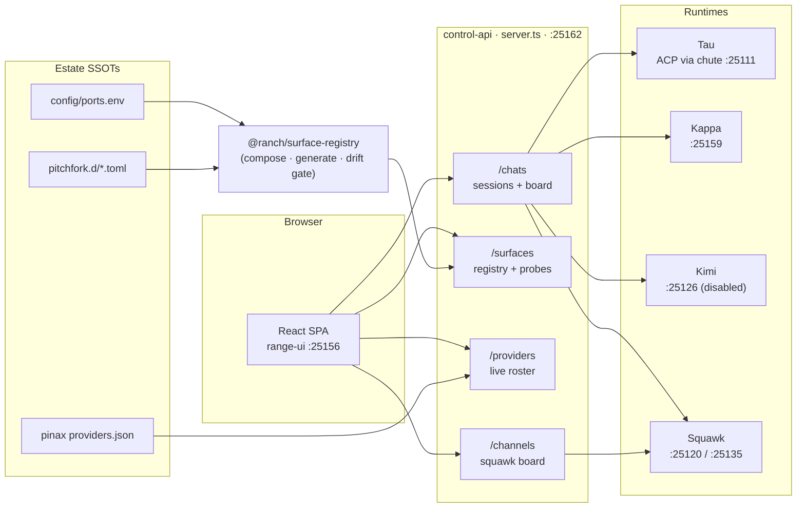

# delendai-control-plane

**The control plane for the estate's agent fleet — every running chat, every
surface, every provider, from one truthful dashboard.**

[](https://github.com/toxicwind/range/actions/workflows/build_and_test.yml)
[](https://github.com/toxicwind/range/actions/workflows/build_and_test.yml)
[](apps/delendai-control-plane/vitest.config.ts)
[](apps/delendai-control-plane/vite.config.ts)
[](../../../../estate/config/ports.env)
[](server.ts)

---

## Why should you care?

On this box, **90+ supervised daemons** serve **four** agent runtimes — Tau,
Kappa, Kimi and Squawk. Every one of them has a chat surface, a port, a token
and a lifecycle, and every one of them used to be discoverable only by
`grep`-ing pitchfork output and guessing which port belonged to which agent.

This app is the single pane of glass for that:

- **One `/chats` endpoint** that returns every running agent chat — Tau
  sessions, Kappa sessions, Kimi sessions and the Squawk board channels — with
  honest `live` / `idle` status, never a fixture row.
- **One `/surfaces` endpoint** composed from the estate's own SSOTs
  (`config/ports.env`, `pitchfork.d/*.toml`) by
  [`@ranch/surface-registry`](../../packages/surface-registry/README.md), so a
  daemon rename or a port migration can never orphan a surface.
- **Truthful liveness.** A daemon can be `running` while its socket refuses;
  only an answering socket counts as live. Remote origins are reported as
  _unknown_ (`live: null`), never as _down_.

## Features

- **Agent chat inventory** — Tau rollout files, Kappa SQLite sessions, Kimi
  web sessions and Squawk board channels in one list, sorted live-first.
- **SSOT-driven surfaces** — ports come from `config/ports.env`, daemon state
  from the live supervisor, URLs from the composed registry.
- **Rename-proof resolution** — a surface finds its daemon by id _and_ by
  port, so `estate/estate-chat` → `estate/squawk-chat` changes nothing.
- **Provider truth** — the provider roster is probed at each provider's own
  models endpoint (see
  [`estate/ops/provider-endpoints`](../../../../estate/ops/provider-endpoints/README.md)),
  not inferred from a local gateway.
- **No fixtures, ever** — every panel degrades to a truthful empty state;
  nothing is fabricated to make a dashboard look busy.
- **Graceful CORS** — the SPA on `:25156` and the API on `:25162` talk
  cross-origin without a proxy hop.

## Architecture



### Routes

| Route               | Returns                                        | Source of truth                             |
| ------------------- | ---------------------------------------------- | ------------------------------------------- |
| `GET /health`       | `{ ok, live }`                                 | process liveness                            |
| `GET /services`     | every supervised daemon as a service row       | `pitchfork list`                            |
| `GET /providers`    | provider roster + real reachability            | pinax roster + per-provider probe           |
| `GET /channels`     | Squawk board channels with real message bodies | `~/.fleet-bus/squawk-root`                  |
| `GET /chats`        | every agent chat + the surface registry        | rollout files, SQLite, web daemon, board    |
| `GET /surfaces`     | the surface registry with truthful liveness    | surface registry + live supervisor + probes |
| `GET /dashboards`   | the estate dashboard registry with live flags  | `estate/docs/CONTROL_PLANE.md` + probes     |
| `GET /router/usage` | real usage, or `{ present: false }`            | published usage, never invented             |

### Data sources

| Agent  | Source                                              | Liveness rule                                      |
| ------ | --------------------------------------------------- | -------------------------------------------------- |
| Tau    | `~/.tau/agent/sessions/<project>/<ts>_<uuid>.jsonl` | file mtime inside the 5-minute live window         |
| Kappa  | `~/.local/share/kappa/kappa*.db` (`session` table)  | `time_updated` inside the live window              |
| Kimi   | `kimi-code` web daemon `/api/v1/sessions`           | HTTP probe; empty list when the daemon is disabled |
| Squawk | `~/.fleet-bus/squawk-root/<channel>/`               | newest message timestamp inside the live window    |

## Quick start

```bash
cd apps/delendai-control-plane && bun install    # deps
bun run server                                   # API on :25162 (DELENDAI_CONTROL_API_PORT)
bun run dev                                      # SPA on :25156, /api proxied to the API
```

Then open the dashboard and hit the API directly:

```bash
curl -s http://127.0.0.1:25162/chats    | jq '.summary'
curl -s http://127.0.0.1:25162/surfaces | jq '.[] | {id, port, live}'
```

## Configuration

Every knob is an environment variable with a working default; the port is
never hardcoded — it comes from `config/ports.env`.

| Variable                    | Default                                       | Purpose                                    |
| --------------------------- | --------------------------------------------- | ------------------------------------------ |
| `DELENDAI_CONTROL_API_PORT` | `25162`                                       | API listen port (SSOT: `config/ports.env`) |
| `ESTATE_ROOT`               | `/home/toxic/estate`                          | estate checkout used for the SSOTs         |
| `PINAX_PROVIDERS_JSON`      | `estate/ranch/pinax/generated/providers.json` | provider roster                            |
| `TAU_SESSION_ROOT`          | `~/.tau/agent/sessions`                       | Tau rollout tree                           |
| `KAPPA_STATE_DIR`           | `~/.local/share/kappa`                        | Kappa SQLite profiles                      |
| `KAPPA_BRIDGE_ROOT`         | `~/.fleet-bus/squawk-root`                    | Squawk board root                          |
| `TAU_CHUTE_URL`             | `http://127.0.0.1:25111`                      | local Tau ACP surface                      |
| `KIMI_CODE_URL`             | `http://127.0.0.1:25126`                      | Kimi web daemon                            |
| `HERD_MODELS_URL`           | `http://127.0.0.1:25100/v1/models`            | local model gateway                        |

## Development

```bash
bun run test        # vitest — 6 files, 51 tests
bun run lint        # eslint
bun run build       # tsc -b && vite build
bun run server      # Bun-native API (server.ts)
```

- **Aliases** — `@/*` → `src/*` (see `vite.config.ts` and `tsconfig.json`).
- **Server** — `server.ts` is a Bun-native HTTP server on purpose: no
  framework, no build step, and it can be restarted in under a second.
- **Registry** — never edit `packages/surface-registry/src/generated/*`; run
  its `generate` command and commit the result.

### Contributing

1. Branch off `main` (`feat/…`, `fix/…`).
2. Add a test next to the behaviour you change — the suites are fast
   (sub-second) and are the gate that keeps the dashboard honest.
3. Keep the "no fixtures, ever" rule: an empty state is a valid answer.
4. Open a PR; CI runs lint, types, tests and the registry drift gate.

## License & security

- **License** — see the repository `LICENSE`.
- **Secrets** — no token is ever committed or echoed. Squawk/Kappa
  credentials live in the keyring (`estate/ranch/barn/secretsmith`) and are
  read at runtime; the generated registry deliberately omits secret-looking
  env values and lists only their key names.
- **Exposure** — the API binds `127.0.0.1` only. CORS allows only the
  control-plane SPA origins.
