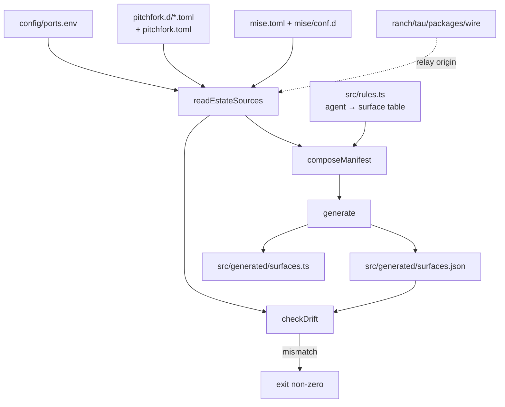

# @ranch/surface-registry

**The machine-readable truth about every agent-chat surface on the estate —
which daemon backs it, which port it listens on, and who owns the code.**

[](../../.github/workflows/build_and_test.yml)
[](../../.github/workflows/build_and_test.yml)
[](vitest.config.ts)
[](src/cli.ts)
[](src/drift.ts)
[](../../../../estate/config/ports.env)

---

## Why should you care?

A chat surface is a **daemon id + a port + a URL + an auth mode**. Write that
tuple down by hand and it rots within a day: a daemon is renamed, a port key
changes, a relay origin disappears. Then the dashboard points at a port that
belongs to something else, or at a URL that no longer answers — and nobody
notices, because the row still _renders_.

This package makes that tuple **derived, not written**:

- The estate's SSOTs are the only inputs: `config/ports.env` owns every port
  number, `pitchfork.d/*.toml` owns every daemon, `mise.toml` owns every task.
- The output is **deterministic** — same estate, byte-identical manifest — so
  the drift gate can compare two derivations exactly.
- **No consumer hardcodes a port.** The rules name SSOT _keys_ and daemon
  _ids_; the numbers only exist in the generated artifact.
- A renamed port key never orphans a surface: rules carry
  `portKeyFallbacks`, so `ESTATE_CHAT_PORT` → `SQUAWK_CHAT_PORT` keeps
  resolving until the SSOT itself is migrated.

## Features

- **Compose** — ports, daemons, surfaces and mise tasks in one manifest.
- **Generate** — writes `surfaces.json` (HTTP consumers) and `surfaces.ts`
  (bundlers) with a "do not edit" header.
- **Drift gate** — re-derives and diffs; a stale committed artifact fails CI
  instead of shipping.
- **Secret hygiene** — env values that look like secrets are never published;
  only their key names are listed in `omittedEnvKeys`.
- **Rename-proofing** — the consumer resolves a daemon by id _and_ by port.
- **Typed** — `AgentKind`, `SurfaceAuthMode` and the manifest shapes are
  exported, so a consumer cannot invent its own vocabulary.

## Architecture



### The rules table

`src/rules.ts` is the only place that knows which daemon backs which agent's
UI. It names **keys and ids**, never numbers:

| Agent  | Surface          | Daemon id        | Port key                                  | Auth     |
| ------ | ---------------- | ---------------- | ----------------------------------------- | -------- |
| tau    | `tau-collab-web` | —                | relay origin                              | room-key |
| tau    | `tau-acp`        | `tau-chute`      | `TAU_CHUTE_PORT`                          | none     |
| kappa  | `kappa-console`  | `kappa-acp`      | `KAPPA_ACP_PORT`                          | basic    |
| kimi   | `kimi-web`       | `kimi-code`      | `KIMI_CODE_PORT`                          | bearer   |
| squawk | `squawk-chat`    | `squawk-chat`    | `SQUAWK_CHAT_PORT` (→ `ESTATE_CHAT_PORT`) | bearer   |
| squawk | `squawk-feed`    | `squawk-feed`    | `SQUAWK_FEED_PORT`                        | bearer   |
| squawk | `squawk-ws`      | `squawk-ws`      | `SQUAWK_WS_PORT`                          | bearer   |
| squawk | `squawk-history` | `squawk-history` | `SQUAWK_HISTORY_PORT`                     | none     |
| squawk | `squawk-ui`      | `fleet-ui`       | `FLEET_UI_PORT`                           | none     |

## Quick start

```bash
node --experimental-strip-types src/cli.ts generate   # regenerate the committed manifest
node --experimental-strip-types src/cli.ts check      # drift gate (exit non-zero on drift)
./node_modules/.bin/vitest run                       # 6 files, 62 tests
```

Both commands accept `--estate-root <dir>` (default `/home/toxic/estate`) and
`--out-dir <dir>` (default `src/generated`). `generate` prints `unchanged`
when the committed artifact is already correct, so it is safe in a pre-commit
hook.

## Layout

| File                            | What it does                                                                                           |
| ------------------------------- | ------------------------------------------------------------------------------------------------------ |
| `src/ports-env.ts`              | parser for `config/ports.env`                                                                          |
| `src/toml.ts`                   | the TOML subset the estate manifests use (tables, dotted keys, inline tables, arrays, array-of-tables) |
| `src/pitchfork.ts`              | parser for `pitchfork.d/*.toml` and `pitchfork.toml`                                                   |
| `src/mise.ts`                   | parser for `mise.toml` and `mise/conf.d/*.toml`                                                        |
| `src/estate.ts`                 | reads the estate SSOTs from disk                                                                       |
| `src/manifest.ts`               | the shape of the generated manifest                                                                    |
| `src/rules.ts`                  | the agent → surface table (SSOT keys and daemon ids only)                                              |
| `src/compose.ts`                | turns the parsed SSOTs into the manifest                                                               |
| `src/generate.ts`               | writes `src/generated/surfaces.json` and `src/generated/surfaces.ts`                                   |
| `src/drift.ts`                  | re-derives the manifest and compares it with the committed one                                         |
| `src/cli.ts`                    | the `generate` / `check` commands                                                                      |
| `src/testing/estate-fixture.ts` | builds a throwaway estate fixture for the tests                                                        |

## The generated manifest

`src/generated/surfaces.json` and `src/generated/surfaces.ts` are the same
manifest in two shapes: JSON for HTTP consumers, a typed module for bundlers.
Both are generated; both carry a header that says so.

The manifest publishes:

- `ports` — only the port keys a chat surface depends on.
- `daemons` — only the daemons a chat surface depends on, with their port,
  run line and `ready_http` / `health_http`. Secret-looking env values are
  **never** published; their key names are listed in `omittedEnvKeys` so the
  omission is visible without leaking anything.
- `surfaces` — one entry per rule: the agent, id, port, port key, base URL,
  web/api/health paths, auth mode and the owning repo/dir.

## Consumers

1. **The control-plane API** imports the composed manifest and enriches it
   with live supervisor state and real liveness probes
   (`apps/delendai-control-plane/server.ts`).
2. **The SPA** reads the same artifact, so API and UI can never disagree.
3. **CI** runs the drift gate: `check` must exit 0 and `generate` must report
   `unchanged`.

## Contributing

1. Add or change a surface by editing `src/rules.ts` — never the generated
   files.
2. Name SSOT **keys** and daemon **ids**, never port numbers.
3. Run `generate` and commit the regenerated artifacts together with the rule
   change.
4. Run `check` and the test suite; both must be green.

## License & security

- **License** — see the repository `LICENSE`.
- **Security** — the manifest is a committed artifact, so it must never carry
  a secret. Daemon env values that are not ports are dropped by construction;
  only their key names survive, so a leak is visible without leaking.
